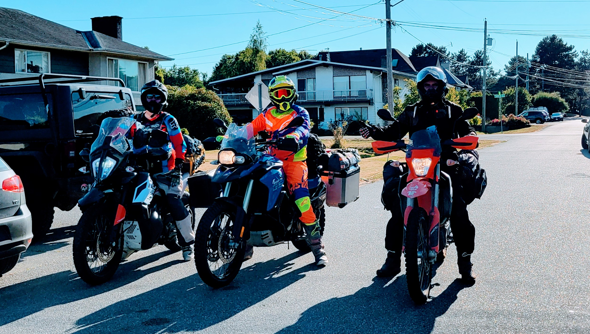
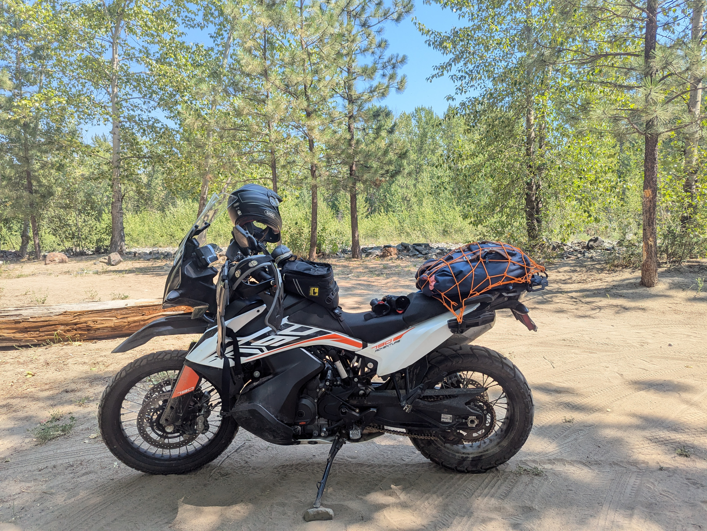
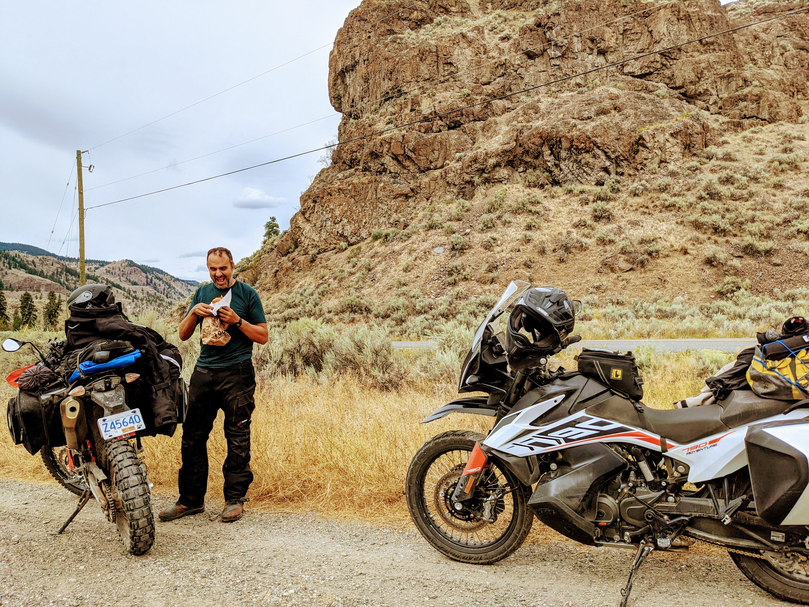

There is something incredibly clarifying about packing up the gear, leaving the city grid behind, and pointing the front wheel toward the mountains. This past weekend was all about getting off the pavement, logging some solid miles, and spending a few good nights under the stars.

We mapped out a solid route starting from Richmond, heading up through Pemberton, tackling the Highline Road, pushing into Lillooet, and finally carving our way down the canyon back home.

Here is the recap from the trail.

### 1. Rolling Out of Richmond

The trip started the way all good ones do: early in the morning, engines idling in the neighborhood, and the crew doing the final radio checks. Getting out of the lower mainland traffic is always a chore, but the anticipation of the Sea-to-Sky corridor makes the slog worth it.

**Route Highlights - Leg 1:**

* **Richmond to Squamish:** Standard highway cruising to shake down the gear.
* **Squamish to Pemberton:** Winding out the throttles and taking in the coastal mountain air.
* **Pemberton Gas Stop:** Topping off the tanks and grabbing extra water before the tarmac ended.

---

### 2. The Highline Road & Off-Grid Camping

Once we hit Pemberton, the real fun began. We transitioned off the highway and onto the Highline Road. For anyone who hasn't ridden it, it’s a phenomenal Forest Service Road (FSR) that offers a perfect mix of technical dirt, sweeping vistas, and plenty of elevation changes.

After a long day of wrestling the bikes through the dust and gravel, we found a stellar spot off the beaten path to set up camp. There’s nothing better than stripping the heavy luggage off the bike, setting up a tent, and settling in for the night.

**Camp Setup Essentials:**

* Secured the dry bags and shed the extra weight off the tail.
* Pitched tents in the soft sand under the tree canopy.
* Spent the evening trading stories and prepping the bikes for the next day's descent.

---

### 3. The Lillooet Canyon Descent

The next morning, we pushed through the remainder of the Highline Road into Lillooet. The geography shifts dramatically here—leaving the dense alpine trees for arid, rugged canyon walls. The temperature spiked, and the riding became a completely different game.

Riding down the canyon is sweeping, fast, and visually stunning. The sheer scale of the rock walls makes you realize just how small you are on two wheels. We had to pull over on a gravel shoulder at the base of a massive rock face just to cool down, hydrate, and crush a quick road snack.

### 4. The Final Stretch Home

After our roadside lunch, we tackled the rest of the canyon twisties. The descent back down toward the coast is a steady unwinding of the tension you build up navigating FSRs. By the time we hit the familiar roads back into Richmond, the bikes were covered in dust, the gear was thoroughly broken in, and the trip was a confirmed success.

**Ride Stats:**

* **Terrain:** 60% Tarmac / 40% FSR & Gravel
* **Vibe:** Unplugged and completely off-grid
* **Verdict:** The Highline Road remains one of the best accessible backcountry routes in the province.

Time to clean the air filters, check the chain tension, and start planning the next one.
